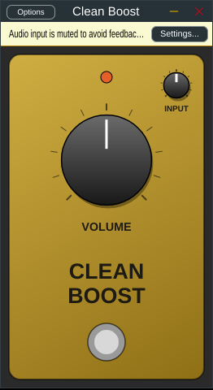

# Clean Boost

A VST3 / AU / Standalone plugin modelled on a classic one-transistor clean boost
circuit (2N5088, common emitter, 9 V).



## Circuit

| Part | Value | Role |
| ---- | ----- | ---- |
| C1 | 100 nF | Input coupling. With the stage's ~30 kΩ input impedance, a high-pass at ~50 Hz |
| R1 / R2 | 430 kΩ / 43 kΩ | Base bias divider (~0.8 V) |
| Q1 | 2N5088 | Gain transistor |
| R3 | 10 kΩ | Collector load |
| R4 | 390 Ω | Emitter degeneration. Sets the gain at Rc / (re + Re), about 26 dB |
| C2 | 100 nF | Output coupling. With R3 + VR1, a high-pass at ~15 Hz |
| VR1 | 100 kΩ (A) | Volume |

## How it's modelled

`Source/BoostCircuit.h` is a component-level model, not a generic waveshaper:

- The bias divider is a Thevenin source driving the base node.
- C1 is a trapezoidal companion model, solved together with the base node, so
  the low end changes as the transistor's input impedance changes.
- Q1 is an exponential junction with finite beta and emitter degeneration,
  solved every sample with Newton-Raphson. This produces the real circuit's
  soft, asymmetric clipping when driven hard.
- Collector saturation is a smooth current limit.
- The circuit runs at 4x oversampling to keep clipping harmonics from aliasing.

The model's numbers, from the tests: DC collector at 4.8 V, 26 dB of gain at 1 kHz,
flat to 20 kHz, −3 dB at ~50 Hz.

## Controls

- **Volume**: the pedal's only knob (audio taper). About 4 on the dial is unity
  gain, noon (5) is about +5 dB, and fully up is +26 dB.
- **Input** (small knob): not on the real pedal. It sets how many volts a
  full-scale sample represents (0 dB means 1 V peak). Turn it up to drive the
  transistor into clipping, or down for a cleaner boost.

## Building

Requires CMake 3.22+ and a C++17 compiler. JUCE is downloaded automatically.

```sh
cmake -S . -B build -DCMAKE_BUILD_TYPE=Release
cmake --build build --config Release
ctest --test-dir build -C Release      # circuit + processor tests
```

Plugins end up in `build/CleanBoost_artefacts/Release/` (`VST3/`, `AU/` on macOS,
`Standalone/`). Copy them to your plugin folder:

- macOS: `~/Library/Audio/Plug-Ins/VST3` and `~/Library/Audio/Plug-Ins/Components`
- Windows: `C:\Program Files\Common Files\VST3`
- Linux: `~/.vst3`

On Linux, install JUCE's dependencies first, for example
`sudo apt install libasound2-dev libx11-dev libxrandr-dev libxinerama-dev libxcursor-dev libfreetype-dev libfontconfig1-dev`.

On macOS, build with `-G Xcode` if you want an Xcode project. For AU, run
`auval -v aufx Clbt Diyp` after installing to validate it.
